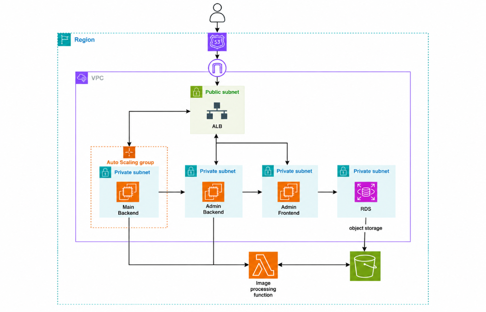

# 🥛 Dairy Backend (`Dairy-Backend`)

Core backend API service for the Dairy Marketplace & Subscription platform built with **NestJS**, **Prisma ORM**, **PostgreSQL**, and **Redis**.

- **GitHub Repository:** [https://github.com/MaheshKumarBisai/Dairy-Backend.git](https://github.com/MaheshKumarBisai/Dairy-Backend.git)
- **Default Port:** `4000`

---

## 🏗️ System Architecture & AWS Infrastructure



### Architecture Overview & Key AWS Services

The platform follows a secure, scalable multi-tier architecture partitioned across public and private subnets inside an **AWS VPC**:

1. **DNS & Ingress Layer**:
   - **AWS Route 53**: Handles global DNS resolution and points incoming client traffic to the ingress.
   - **Internet Gateway (IGW)**: Public gateway connecting external users to the platform's VPC.
   - **Application Load Balancer (ALB)** (Public Subnet): SSL termination and intelligent routing:
     - Routes customer/mobile traffic to the **Main Backend**.
     - Routes administrative API requests to the **Admin Backend**.
     - Routes administrative dashboard requests to the **Admin Frontend**.

2. **Compute & Application Layer (Private Subnets)**:
   - **Main Backend (NestJS)**: Deployed inside an **Auto Scaling Group (ASG)** across private subnets for high availability and automatic horizontal scaling based on load.
   - **Admin Backend (Express)**: Manages administrative operations, order lifecycle dispatching, partner management, and metrics.
   - **Admin Frontend**: Web portal for operations, managers, and dispatchers.

3. **Database & Storage Layer**:
   - **Amazon RDS (PostgreSQL)** (Private Subnet): Fully managed, isolated relational database storing users, products, subscriptions, daily orders, and delivery assignments.
   - **Amazon S3 (Object Storage)**: Scalable storage for product images, dairy merchant certifications, and launch media assets.

4. **Serverless Media Processing**:
   - **AWS Lambda ("Image Processing Function")**: Event-driven serverless function triggered by the backends to automatically resize, optimize, and generate responsive web/mobile thumbnails for images uploaded to S3.

---

## 📋 Prerequisites
Before running on a new laptop, ensure the following are installed:
1. **Node.js**: `v20.x` or higher (`node -v`)
2. **npm**: `v10.x` or higher (`npm -v`)
3. **Docker Desktop**: Running (`docker --version`)
4. **Git**: Installed (`git --version`)

---

## ⚡ Step-by-Step Local Setup Guide

Run these commands in order in your terminal:

### 1. Clone the Repository
```bash
git clone https://github.com/MaheshKumarBisai/Dairy-Backend.git
cd Dairy-Backend
```

### 2. Start PostgreSQL & Redis Containers
Start the local database and cache using Docker Compose:
```bash
docker compose up -d
```
> **Services Started:**
> - **PostgreSQL:** `localhost:5433` (Database: `dairy_db`, User: `dairy_user`, Password: `dairy_password`)
> - **Redis:** `localhost:6379`

### 3. Setup Environment Variables
Create your local `.env` configuration file from the template:
```bash
cp .env.example .env
```

### 4. Install Dependencies
```bash
npm install
```

### 5. Setup Database Schema & Seed Data
Push the Prisma schema to the database and generate initial demo data (products, categories, users, delivery partners):
```bash
npx prisma db push
npm run prisma:seed
```

### 6. Start the Backend Server
```bash
npm run start:dev
```

The backend is now live at **http://localhost:4000**!

---

## 🔍 Verify Installation
- **API Health Check:** [http://localhost:4000/api/v1/health](http://localhost:4000/api/v1/health)
- **Interactive Swagger API Docs:** [http://localhost:4000/api/docs](http://localhost:4000/api/docs)

---

## 🔑 Demo Seed Accounts
All accounts use the password: **`Password@123`**

| Role | Email | Name / Notes |
| --- | --- | --- |
| **Customer** | `customer@example.com` | Ananya Roy |
| **Delivery Partner** | `driver.raj@farmfresh.com` | DEL-100001 (Rajesh Kumar) |
| **Merchant** | `merchant@farmfresh.com` | MR-100001 (FarmFresh Dairy) |
| **Merchant** | `merchant@greenvalley.com` | MR-100002 (GreenValley Organics) |
| **Admin** | `admin@dairyplatform.com` | System Admin |

---

## 🌐 Connected Repositories
The other modules of the platform run independently in their own repositories:

| Module | Repository | Port |
| --- | --- | --- |
| **Admin Backend** | [Dairy-Adm-Backend](https://github.com/MaheshKumarBisai/Dairy-Adm-Backend.git) | `4001` |
| **Admin Frontend** | [Dairy-Adm-frontend](https://github.com/MaheshKumarBisai/Dairy-Adm-frontend.git) | `3001` |
| **Customer App** | [Dairy-customer-frontend](https://github.com/MaheshKumarBisai/Dairy-customer-frontend.git) | `5173` |
| **Delivery App** | [Dairy-delivery-frontend](https://github.com/MaheshKumarBisai/Dairy-delivery-frontend.git) | `5174` |
